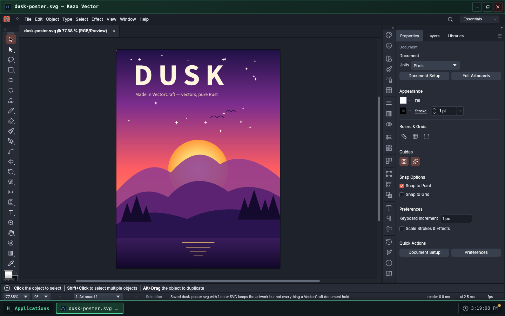
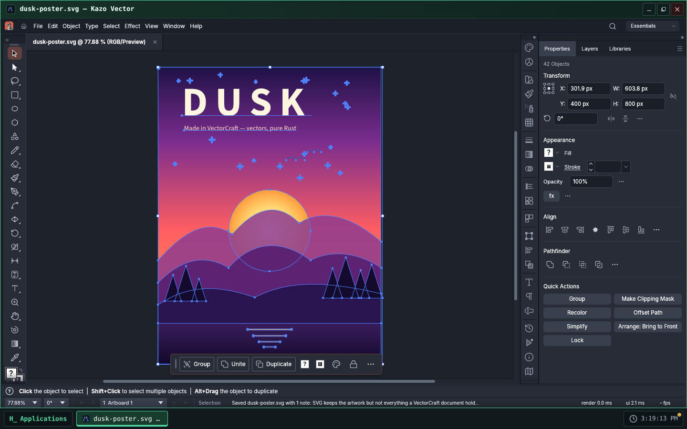
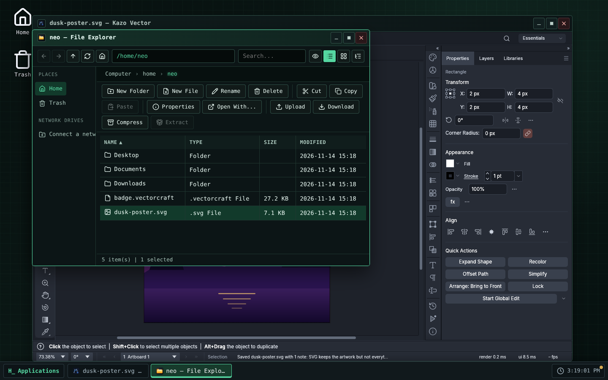

> [Version française](readme-fr.md)

<!-- Store listing: generated from store/ by .github/scripts/store-readme.mjs. Edit store/, then run it. -->


# Kazo Vector

A vector drawing app for Kazo OS: logos, illustrations, icons, posters and diagrams. Kazo Vector is
based on [VectorCraft](https://github.com/storytold/vectorcraft) by the ArtCraft team, an
open-source vector illustration app written in Rust, running here in a Kazo OS window.

## Draw

- Pen, pencil, curvature and shape tools, with real Bézier anchor points and handles.
- Exact path operations (unite, subtract, intersect, divide) and a shape builder.
- Fills, strokes, gradients, swatches, transparency, clipping masks and live effects such as glows
  and shadows.
- Text on a line, in a frame or along a path, with character and paragraph styles.
- Several artboards per drawing, layers, groups, symbols, live blends, smart guides and rulers.
- Unlimited undo.

## Your Kazo OS files

- Double-click a `.svg`, `.svgz`, `.ai`, `.ait`, `.eps`, `.epsf`, `.ps`, `.dxf`, `.emf`, `.wmf`,
  `.vectorcraft` or `.vctemplate` file in the File Explorer: it opens in Kazo Vector. `.pdf` and
  Affinity `.afdesign` files offer it under "Open with".
- Several drawings per window, each in its own tab. File › Open uses the Kazo OS open dialog and
  can open several files at once. A file opened from the File Explorer gets its own window.
- Save writes back to the open file, in its format. Save As, and the first save of a new drawing,
  go through the Kazo OS save dialog.
- Save a Copy and Export (SVG, PDF, PNG, JPEG, WebP, Export for Screens) go through the Kazo OS
  "Save a copy" dialog: the drawing stays bound to its file. Nothing ends up in the browser's
  downloads.
- Closing the window asks before losing changes, and can save every modified drawing first.
- Kazo Vector follows the Kazo OS light or dark theme and its language.

## Known limits

- **VectorCraft is in alpha.** Most drawings open and save well, but keep a copy of the ones that
  matter.
- Kazo OS opens files up to 128 MiB. Very large or very complex drawings can be slow to open and
  draw, especially on a computer without a graphics card.
- No recovery after a crash for now: a drawing that was not saved is lost if the browser or the tab
  closes. Save often.
- VectorCraft's own settings (tool options, panels, preferences) are not kept from one window to
  the next.
- The first save of a new drawing shows two dialogs: VectorCraft's save options (name and format),
  then the Kazo OS save dialog (folder).
- Print uses the browser's print dialog.
- Kazo OS keeps Alt+Shift+Left/Right and Ctrl+Alt+Shift+Left/Right: in vertical text, shift the
  baseline from the Character panel instead. Alt+Space opens the window menu: release Alt before
  panning with Space.
- The window stays on the screen it opened on: moving it to another screen would reload
  VectorCraft and lose the open drawings.
- VectorCraft draws with WebGPU or WebGL 2: a browser or computer with neither shows an error screen
  instead of the drawing.
- The download is about 30 MB (about 72 MB once installed), and each window loads its own copy of
  VectorCraft.
- Requires Kazo OS 3.3.4 or later.

## License

Kazo Vector is free software under the MIT license. VectorCraft is under the MIT or Apache-2.0
license; its notices, the licenses of the material it carries and those of the fonts
(SIL Open Font License 1.1) ship with the app (see `THIRD-PARTY-NOTICES.md` in the repository). The ArtCraft name
and logos are trademarks of the ArtCraft team and are not used by Kazo Vector.

## Screenshots

<p>
  
  
  
</p>

<!-- /Store listing -->

## Try it

[Open Kazo Vector in Kazo OS](https://os.kazo.ca/?autolaunch=ca.kazo.vector): the link starts Kazo OS, installs the app from the official Store and opens it.

Or open [Kazo OS](https://os.kazo.ca/) and install Kazo Vector from the **Kazo OS Store** (category Graphics), or in the Kazo OS Terminal, as an administrator: `sudo kazopkg install Kazo-ca/Os-App-Vector`.

## About Kazo OS

[Kazo OS](https://github.com/Kazo-ca/Os) is a simulated operating system that runs in the browser, written in C# with Blazor WebAssembly. It gives a complete environment to build and run applications: desktop and windows, a persistent file system, processes, a POSIX shell, a simulated network, the Kazo OS Store, and a public SDK (NuGet packages) to make apps such as this one. Try it at <https://os.kazo.ca/> (PWA, works offline).

## Development

- Plan: [plan](doc/en/plan.md) ([documentation index](doc/en/README.md)). VectorCraft is compiled from our fork [`Kazo-ca/vectorcraft`](https://github.com/Kazo-ca/vectorcraft) (host mode added). VectorCraft's notices and the licenses in the package: [THIRD-PARTY-NOTICES.md](THIRD-PARTY-NOTICES.md).

| Folder | Content |
| --- | --- |
| `src/Kazo.Vector` | The app (window app, its `[AppManifest]` class generates `manifest.json`) |
| `src/Kazo.Vector.Os` | A host that runs the whole Kazo OS with the base apps and this app: the project to start |
| `tests/Kazo.Vector.Tests` | Tests of the app (xUnit) |
| `tests/e2e` | End-to-end runs in the Kazo OS host (Playwright): `npm run test:e2e` after `dotnet build Kazo.Vector.slnx -c Debug`; a large file's open and save times: `npm run measure:large -- <file.svg>` |
| `tests/installed` | The app as the Store installs it, in a published Kazo OS: `kazopkg install` (or the Store with `--store`), two windows, a new drawing saved through the OS dialog, an SVG opened by double-click and saved in place, the licenses, the Store screenshots (`npm run test:installed -- [--store] <Kazo OS wwwroot>`) |
| `external/KazoOs` | The Kazo OS repository as a git submodule, on a release tag |
| `external/vectorcraft` | VectorCraft's sources (our fork `Kazo-ca/vectorcraft`) as a git submodule, only to compile VectorCraft (`tools/build-vectorcraft.sh`, workflow Build VectorCraft) |
| `src/Kazo.Vector/wwwroot/vectorcraft` | The VectorCraft web build and its provenance `vectorcraft.json`, written by `tools/build-vectorcraft.sh`, never edited by hand |
| `store/` | What the Kazo OS Store shows: icon (PNG 256×256), short descriptions, descriptions, screenshots, `store.json`; the top of this README is generated from it (`npm run store:readme`, checked in CI) |
| `THIRD-PARTY-NOTICES.md` | VectorCraft and what it bundles; linked into the package with `LICENSE` (`wwwroot/legal/`, with the files VectorCraft's NOTICE refers to in `wwwroot/legal/vectorcraft/`) |

### Compiling VectorCraft

`tools/build-vectorcraft.sh` compiles the commit of `external/vectorcraft` with Trunk 0.21.14, Rust
stable and the `wasm32-unknown-unknown` target, with the `craft-fonts` faces at the revision
VectorCraft's releases pin, optimised for size (`opt-level = "s"` with VectorCraft's thin LTO,
debug info stripped, set by `CARGO_PROFILE_RELEASE_*` without changing the fork), then replaces
`src/Kazo.Vector/wwwroot/vectorcraft/` with the result and its provenance. It fails when the `.wasm`
is above 90 MiB (GitHub refuses files above 100 MiB). The **Build VectorCraft** workflow (Actions
tab) does the same and opens a pull request with the build. To move to another VectorCraft commit:
move the submodule to a commit of the fork, then rebuild; a test fails while the build and the
submodule disagree.

### First steps

```bash
# A repository created from the GitHub template already has the submodule:
git clone --recurse-submodules <your repository>

# A folder made with "dotnet new kazoos-solution" adds it once:
git init
git submodule add --depth 1 https://github.com/Kazo-ca/Os.git external/KazoOs
git -C external/KazoOs checkout v<Kazo OS version>
```

Then open the `Kazo.Vector.slnx` in Visual Studio or Rider and start `Kazo.Vector.Os`, or run
`dotnet run --project src/Kazo.Vector.Os`.

### The Kazo OS version

`external/KazoOs/wasm2/KazoOs/build/Versions.props` is the Kazo OS version of this repository.
To move to another version, move the submodule to its tag and commit it:

```bash
git -C external/KazoOs fetch --depth 1 origin tag v2.2.0
git -C external/KazoOs checkout v2.2.0
git add external/KazoOs
```

Never edit the submodule: the OS is not modified from an app repository, and CI refuses a
submodule with local changes or off its tag.

### Two build profiles

| Profile | Kazo OS comes from | Use |
| --- | --- | --- |
| `Debug` | the projects of the submodule (`KazoOsUseSource=true`) | step into the SDK and the OS, breakpoints anywhere |
| `Release` | the `Kazo.Os.*` packages of nuget.org, at the submodule's version | CI, `dotnet publish`, the Kazo OS Store |

Force either one with `-p:KazoOsUseSource=true` or `false`.

### Publishing to the Kazo OS Store

1. Fill `store/` (icon, short descriptions, descriptions, category and tags in `store.json`).
2. Change `Version` in the app's `[AppManifest]` class and commit it to `main`, then tag it: run the
   **Tag a release** workflow (Actions tab, or the GitHub API for an agent), which tags the head of
   `main` with the manifest's version and starts the two publishing workflows; or push the tag
   yourself: `git tag v1.0.0 && git push --tags`.
3. The **Publish to the Kazo OS Store** workflow builds the app and makes the catalog folder
   `apps/<appId>_<version>/`. With a `HACK_STORE_TOKEN` secret (a token allowed to fork and open
   pull requests), it opens the pull request to `Kazo-ca/Os-AppMarketPlace` from your fork;
   without it, download the run's artifact and open the pull request yourself.
   In the Kazo-ca organisation, the Kazo OS automation app (organisation secrets
   `KAZO_AUTOMATION_APP_ID` and `KAZO_AUTOMATION_APP_KEY`) opens it from a branch of the catalog
   instead, to its `beta` branch for a version with a suffix (`1.2.1-beta.1`).

`HACK_STORE_TOKEN` is a GitHub personal access token of yours, not something Kazo OS gives you:

1. GitHub ▸ **Settings** ▸ **Developer settings** ▸ **Personal access tokens** ▸ **Tokens (classic)** ▸
   **Generate new token (classic)**, with a short expiration and the **`repo`** and **`workflow`**
   scopes (a fine-grained token cannot cover both your fork and the catalog's repository).
2. Copy it (shown once) into this repository: **Settings** ▸ **Secrets and variables** ▸ **Actions** ▸
   **New repository secret**, name `HACK_STORE_TOKEN` (or `gh secret set HACK_STORE_TOKEN`).

`repo` reaches all your repositories: keep the token only in this secret and revoke it if in doubt.

The catalog never takes a binary from you: once your pull request is reviewed and merged, its CI
compiles the app at the tagged commit.

### Following new Kazo OS versions

The **Kazo OS SDK update** workflow (`sdk-update.yml`) runs every hour, when Kazo OS announces a
release, or by hand from the Actions tab. When Kazo OS has a newer version, it moves the submodule
to it, raises the app's version (`.github/scripts/bump-app-version.sh`) on a `kazoos-sdk/<version>`
branch and runs the CI there:

- a Kazo OS pre-release: the `beta` branch takes it, as version `x.y.(z+1)-beta.<n>`, which goes to
  the beta channel of the Kazo OS Store;
- a minor or major stable release: a pull request to `main`, merged, tagged and published;
- a patch stable release: checked only, nothing is published.

A red CI opens a `TODO` issue and changes nothing. A version with a suffix (`1.2.1-beta.1`) is
always published from `beta`, one without from `main`. The workflows of this repository are short:
they call the shared workflows of [Kazo-ca/Os-AppTemplate](https://github.com/Kazo-ca/Os-AppTemplate)
(`@v1`), so they improve without a change here. Without the Kazo OS automation secrets, allow GitHub
Actions to create pull requests (**Settings** ▸ **Actions** ▸ **General**) for the update to open its
pull request.

### Publishing on the `kazoos-packages` branch

The same `v*` tag also runs **Publish the Kazo OS packages**: it packs the app and pushes it to the
`kazoos-packages` branch of this repository, keeping the versions already published. Kazo OS
users then install it with `kazopkg install <owner>/<repo>`, without the Kazo OS Store.

These packages are not signed: apps are signed only in the Kazo OS Store repository
(`Kazo-ca/Os-AppMarketPlace`), when it builds your app from the catalog (ADR 0219). Kazo OS checks
them by their SHA-256 and asks an administrator before installing from an untrusted source. Users
who want a signed package install your app from the Kazo OS Store.
