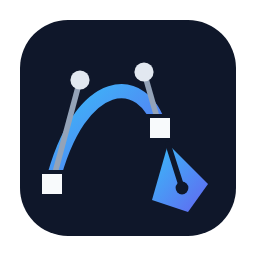
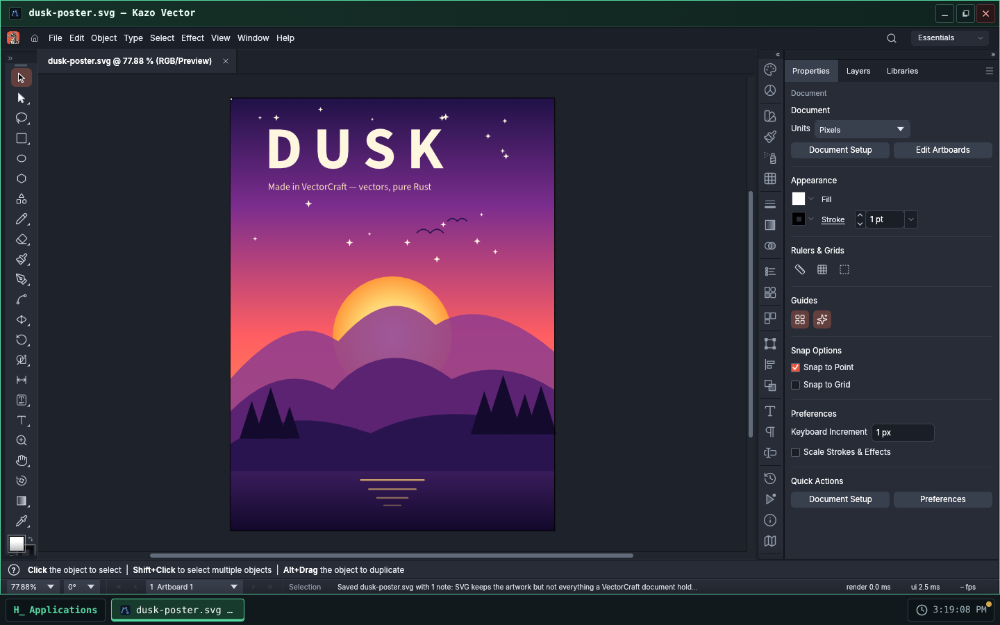
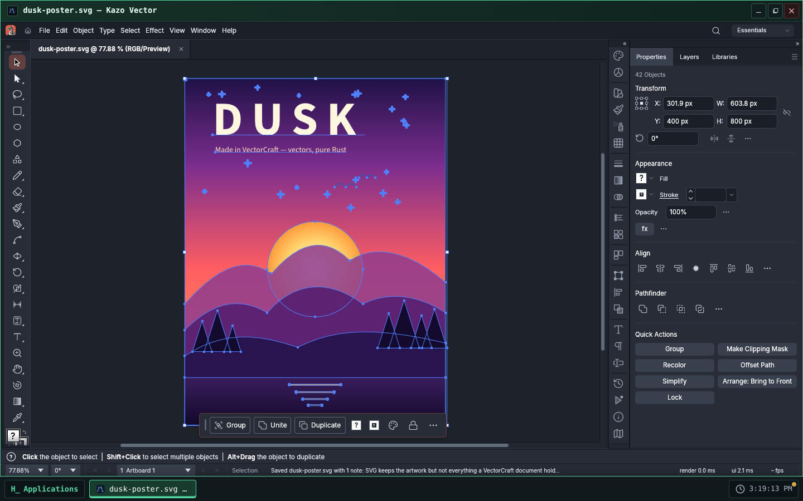
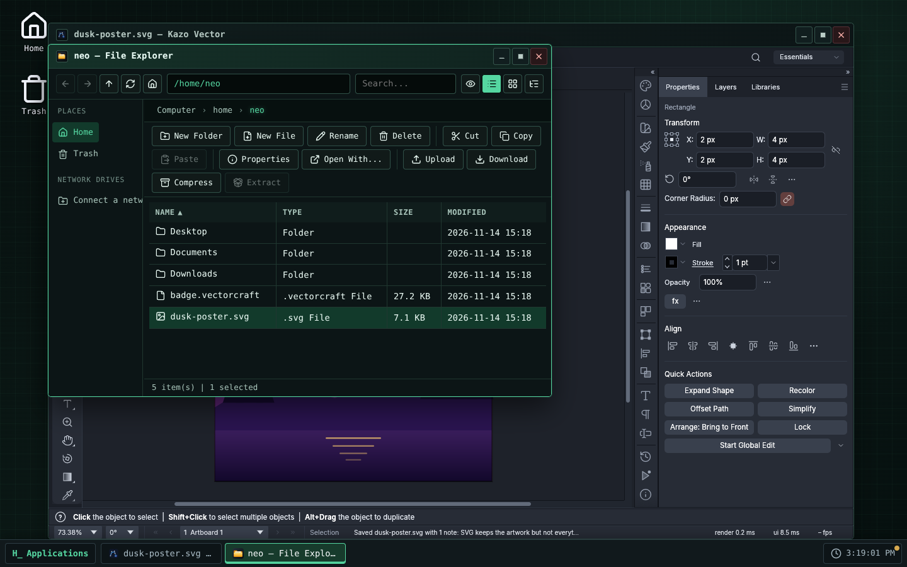

> [English version](README.md)

<!-- Fiche du Store : générée depuis store/ par .github/scripts/store-readme.mjs. Modifiez store/, puis lancez-le. -->



# Kazo Vector

Une app de dessin vectoriel pour Kazo OS : logos, illustrations, icônes, affiches et schémas. Kazo
Vector est basé sur [VectorCraft](https://github.com/storytold/vectorcraft) de l'équipe ArtCraft,
une app d'illustration vectorielle libre écrite en Rust, qui tourne ici dans une fenêtre de Kazo OS.

## Dessiner

- Plume, crayon, outil courbe et outils de formes, avec de vrais points d'ancrage et poignées de
  Bézier.
- Opérations exactes sur les tracés (réunir, soustraire, intersection, diviser) et un outil de
  construction de formes.
- Fonds, contours, dégradés, nuanciers, transparence, masques d'écrêtage et effets en direct comme
  les lueurs et les ombres.
- Texte sur une ligne, dans un cadre ou le long d'un tracé, avec styles de caractère et de
  paragraphe.
- Plusieurs plans de travail par dessin, calques, groupes, symboles, dégradés de formes en direct,
  repères commentés et règles.
- Annulation sans limite.

## Vos fichiers Kazo OS

- Double-cliquez sur un fichier `.svg`, `.svgz`, `.ai`, `.ait`, `.eps`, `.epsf`, `.ps`, `.dxf`,
  `.emf`, `.wmf`, `.vectorcraft` ou `.vctemplate` dans l'Explorateur de fichiers : il s'ouvre dans
  Kazo Vector. Les fichiers `.pdf`
  et Affinity `.afdesign` le proposent dans « Ouvrir avec ».
- Plusieurs dessins par fenêtre, chacun dans son onglet. Fichier › Ouvrir passe par le dialogue
  d'ouverture de Kazo OS et peut ouvrir plusieurs fichiers d'un coup. Un fichier ouvert depuis
  l'Explorateur a sa propre fenêtre.
- Enregistrer réécrit le fichier ouvert, au même format. Enregistrer sous, et le premier
  enregistrement d'un nouveau dessin, passent par le dialogue d'enregistrement de Kazo OS.
- Enregistrer une copie et Exporter (SVG, PDF, PNG, JPEG, WebP, export pour écrans) passent par le
  dialogue « Enregistrer une copie » de Kazo OS : le dessin reste lié à son fichier. Rien ne part
  dans les téléchargements du navigateur.
- Fermer la fenêtre demande avant de perdre des modifications, et peut d'abord enregistrer chaque
  dessin modifié.
- Kazo Vector suit le thème clair ou sombre de Kazo OS et sa langue.

## Limites connues

- **VectorCraft est en alpha.** La plupart des dessins s'ouvrent et s'enregistrent bien, mais
  gardez une copie des plus importants.
- Kazo OS ouvre les fichiers jusqu'à 128 Mio. Les dessins très grands ou très complexes peuvent être
  lents à ouvrir et à afficher, surtout sur un ordinateur sans carte graphique.
- Pas de récupération après un arrêt brutal pour l'instant : un dessin non enregistré est perdu si
  le navigateur ou l'onglet se ferme. Enregistrez souvent.
- Les réglages de VectorCraft (options des outils, panneaux, préférences) ne sont pas gardés d'une
  fenêtre à l'autre.
- Le premier enregistrement d'un nouveau dessin montre deux dialogues : les options
  d'enregistrement de VectorCraft (nom et format), puis le dialogue d'enregistrement de Kazo OS
  (dossier).
- Imprimer passe par le dialogue d'impression du navigateur.
- Kazo OS garde Alt+Maj+Gauche/Droite et Ctrl+Alt+Maj+Gauche/Droite : dans le texte vertical,
  décalez la ligne de base depuis le panneau Caractère. Alt+Espace ouvre le menu de la fenêtre :
  lâchez Alt avant de déplacer la vue avec Espace.
- La fenêtre reste sur l'écran où elle s'est ouverte : la passer sur un autre écran rechargerait
  VectorCraft et perdrait les dessins ouverts.
- VectorCraft dessine avec WebGPU ou WebGL 2 : un navigateur ou un ordinateur sans l'un ni l'autre
  montre un écran d'erreur au lieu du dessin.
- Le téléchargement fait environ 30 Mo (environ 72 Mo une fois installé), et chaque fenêtre charge
  sa propre copie de VectorCraft.
- Demande Kazo OS 3.3.4 ou plus récent.

## Licence

Kazo Vector est un logiciel libre sous licence MIT. VectorCraft est sous licence MIT ou Apache-2.0 ;
ses avis, les licences du matériel qu'il contient, et celles des polices (SIL Open Font License
1.1) sont livrés avec l'app (voir `THIRD-PARTY-NOTICES-fr.md` dans le dépôt). Le nom et les logos
ArtCraft sont des marques de l'équipe ArtCraft et ne sont pas utilisés par Kazo Vector.

## Captures d'écran

<p>
  
  
  
</p>

<!-- /Fiche du Store -->

## Essayer

[Ouvrir Kazo Vector dans Kazo OS](https://os.kazo.ca/?autolaunch=ca.kazo.vector) : le lien démarre Kazo OS, installe l'app depuis le Store officiel et l'ouvre.

Ou ouvrez [Kazo OS](https://os.kazo.ca/) et installez Kazo Vector depuis le **Kazo OS Store** (catégorie Graphisme), ou dans le Terminal de Kazo OS, en administrateur : `sudo kazopkg install Kazo-ca/Os-App-Vector`.

## À propos de Kazo OS

[Kazo OS](https://github.com/Kazo-ca/Os) est un système d'exploitation simulé qui tourne dans le navigateur, écrit en C# avec Blazor WebAssembly. Il offre un environnement complet pour développer et exécuter des applications : bureau et fenêtres, système de fichiers persistant, processus, shell POSIX, réseau simulé, le Kazo OS Store, et un SDK public (paquets NuGet) pour créer des apps comme celle-ci. Essayez-le sur <https://os.kazo.ca/> (PWA, fonctionne hors ligne).

## Développement

- Plan : [plan](doc/fr/plan.md) ([index de la documentation](doc/fr/README.md)). VectorCraft est compilé depuis notre fork [`Kazo-ca/vectorcraft`](https://github.com/Kazo-ca/vectorcraft) (mode hébergé ajouté). Les avis de VectorCraft et les licences du paquet : [THIRD-PARTY-NOTICES-fr.md](THIRD-PARTY-NOTICES-fr.md).

| Dossier | Contenu |
| --- | --- |
| `src/Kazo.Vector` | L'app (app fenêtrée, sa classe `[AppManifest]` génère `manifest.json`) |
| `src/Kazo.Vector.Os` | Un hôte qui lance tout Kazo OS avec les apps de base et cette app : le projet à démarrer |
| `tests/Kazo.Vector.Tests` | Tests de l'app (xUnit) |
| `tests/e2e` | Parcours de bout en bout dans l'hôte Kazo OS (Playwright) : `npm run test:e2e` après `dotnet build Kazo.Vector.slnx -c Debug` ; temps d'ouverture et d'enregistrement d'un grand fichier : `npm run measure:large -- <fichier.svg>` |
| `tests/installed` | L'app telle que le Store l'installe, dans un Kazo OS publié : `kazopkg install` (ou le Store avec `--store`), deux fenêtres, un nouveau dessin enregistré par le dialogue de l'OS, un SVG ouvert par double-clic et enregistré en place, les licences, les captures du Store (`npm run test:installed -- [--store] <wwwroot de Kazo OS>`) |
| `external/KazoOs` | Le dépôt de Kazo OS en sous-module git, sur une étiquette de version |
| `external/vectorcraft` | Les sources de VectorCraft (notre fork `Kazo-ca/vectorcraft`) en sous-module git, seulement pour compiler VectorCraft (`tools/build-vectorcraft.sh`, workflow Build VectorCraft) |
| `src/Kazo.Vector/wwwroot/vectorcraft` | Le build web de VectorCraft et sa provenance `vectorcraft.json`, écrits par `tools/build-vectorcraft.sh`, jamais modifiés à la main |
| `store/` | Ce que montre le Store de Kazo OS : icône (PNG 256×256), descriptions courtes, descriptions, captures, `store.json` ; le haut de ce README en est généré (`npm run store:readme`, vérifié en CI) |
| `THIRD-PARTY-NOTICES-fr.md` | VectorCraft et ce qu'il intègre ; lié dans le paquet avec `LICENSE` (`wwwroot/legal/`, avec les fichiers dont parle le NOTICE de VectorCraft dans `wwwroot/legal/vectorcraft/`) |

### Compiler VectorCraft

`tools/build-vectorcraft.sh` compile le commit de `external/vectorcraft` avec Trunk 0.21.14, Rust
stable et la cible `wasm32-unknown-unknown`, avec les polices de `craft-fonts` à la révision
qu'épinglent les versions de VectorCraft, optimisé pour la taille (`opt-level = "s"` avec le LTO
« thin » de VectorCraft, infos de débogage retirées, réglés par `CARGO_PROFILE_RELEASE_*` sans
changer le fork), puis remplace `src/Kazo.Vector/wwwroot/vectorcraft/` par le résultat et sa
provenance. Il échoue si le `.wasm` dépasse 90 Mio (GitHub refuse les fichiers de plus de 100 Mio).
Le workflow **Build VectorCraft** (onglet Actions) fait de même et ouvre une pull request avec le
build. Pour passer à un autre commit de VectorCraft : déplacer le sous-module sur un commit du fork,
puis recompiler ; un test échoue tant que le build et le sous-module ne concordent pas.

### Premiers pas

```bash
# Un dépôt créé depuis le template GitHub a déjà le sous-module :
git clone --recurse-submodules <votre dépôt>

# Un dossier créé par « dotnet new kazoos-solution » l'ajoute une fois :
git init
git submodule add --depth 1 https://github.com/Kazo-ca/Os.git external/KazoOs
git -C external/KazoOs checkout v<version de Kazo OS>
```

Ouvrez ensuite `Kazo.Vector.slnx` dans Visual Studio ou Rider et démarrez `Kazo.Vector.Os`,
ou lancez `dotnet run --project src/Kazo.Vector.Os`.

### La version de Kazo OS

`external/KazoOs/wasm2/KazoOs/build/Versions.props` est la version de Kazo OS de ce dépôt.
Pour changer de version, placez le sous-module sur son tag et validez-le :

```bash
git -C external/KazoOs fetch --depth 1 origin tag v2.2.0
git -C external/KazoOs checkout v2.2.0
git add external/KazoOs
```

Ne modifiez jamais le sous-module : on ne modifie pas l'OS depuis un dépôt d'app, et la CI refuse
un sous-module modifié ou hors de son tag.

### Deux profils de build

| Profil | Kazo OS vient de | Usage |
| --- | --- | --- |
| `Debug` | les projets du sous-module (`KazoOsUseSource=true`) | entrer dans le SDK et l'OS, points d'arrêt partout |
| `Release` | les paquets `Kazo.Os.*` de nuget.org, à la version du sous-module | CI, `dotnet publish`, le Kazo OS Store |

Forcez l'un ou l'autre avec `-p:KazoOsUseSource=true` ou `false`.

### Publier dans le Kazo OS Store

1. Remplissez `store/` (icône, descriptions courtes, descriptions, catégorie et étiquettes dans `store.json`).
2. Changez `Version` dans la classe `[AppManifest]` de l'app et validez-la dans `main`, puis posez le
   tag : lancez le workflow **Tag a release** (onglet Actions, ou l'API GitHub pour un agent), qui pose
   sur la tête de `main` le tag de la version du manifeste et lance les deux workflows de
   publication ; ou poussez le tag vous-même : `git tag v1.0.0 && git push --tags`.
3. Le workflow **Publish to the Kazo OS Store** compile l'app et produit le dossier du catalogue
   `apps/<appId>_<version>/`. Avec un secret `HACK_STORE_TOKEN` (un jeton qui peut créer un fork et
   ouvrir des pull requests), il ouvre la pull request vers `Kazo-ca/Os-AppMarketPlace` depuis
   votre fork ; sans lui, téléchargez l'artefact du workflow et ouvrez la pull request vous-même.
   Dans l'organisation Kazo-ca, l'automate de Kazo OS (secrets d'organisation
   `KAZO_AUTOMATION_APP_ID` et `KAZO_AUTOMATION_APP_KEY`) l'ouvre plutôt depuis une branche du
   catalogue, vers sa branche `beta` pour une version avec un suffixe (`1.2.1-beta.1`).

`HACK_STORE_TOKEN` est un jeton d'accès personnel GitHub à vous, que Kazo OS ne fournit pas :

1. GitHub ▸ **Settings** ▸ **Developer settings** ▸ **Personal access tokens** ▸ **Tokens (classic)** ▸
   **Generate new token (classic)**, avec une expiration courte et les scopes **`repo`** et
   **`workflow`** (un jeton à grain fin ne peut pas couvrir à la fois votre fork et le dépôt du catalogue).
2. Copiez-le (affiché une seule fois) dans ce dépôt : **Settings** ▸ **Secrets and variables** ▸
   **Actions** ▸ **New repository secret**, nom `HACK_STORE_TOKEN` (ou `gh secret set HACK_STORE_TOKEN`).

`repo` donne accès à tous vos dépôts : gardez le jeton dans ce seul secret et révoquez-le au moindre doute.

Le catalogue ne prend jamais de binaire de votre part : une fois votre pull request relue et
fusionnée, sa CI compile l'app au commit du tag.

### Suivre les nouvelles versions de Kazo OS

Le workflow **Kazo OS SDK update** (`sdk-update.yml`) tourne toutes les heures, quand Kazo OS
annonce une version, ou à la main depuis l'onglet Actions. Quand Kazo OS a une version plus récente,
il y déplace le sous-module, monte la version de l'app (`.github/scripts/bump-app-version.sh`) sur
une branche `kazoos-sdk/<version>` et y lance la CI :

- une préversion de Kazo OS : la branche `beta` la reçoit, en version `x.y.(z+1)-beta.<n>`, qui va
  dans le canal bêta du Kazo OS Store ;
- une version stable mineure ou majeure : une pull request vers `main`, fusionnée, taguée et publiée ;
- une version stable corrective : vérifiée seulement, rien n'est publié.

Une CI rouge ouvre une issue `TODO` et ne change rien. Une version avec un suffixe (`1.2.1-beta.1`)
se publie toujours depuis `beta`, une version sans suffixe depuis `main`. Les workflows de ce dépôt
sont courts : ils appellent les workflows partagés de
[Kazo-ca/Os-AppTemplate](https://github.com/Kazo-ca/Os-AppTemplate) (`@v1`), qui s'améliorent sans
changement ici. Sans les secrets de l'automate de Kazo OS, autorisez GitHub Actions à créer des pull
requests (**Settings** ▸ **Actions** ▸ **General**) pour que la mise à jour ouvre sa pull request.

### Publier sur la branche `kazoos-packages`

Le même tag `v*` lance aussi **Publish the Kazo OS packages** : il fait le paquet de l'app et le
pousse sur la branche `kazoos-packages` de ce dépôt, en gardant les versions déjà publiées. Les
utilisateurs de Kazo OS l'installent alors avec `kazopkg install <owner>/<repo>`, sans le Kazo OS Store.

Ces paquets ne sont pas signés : les apps sont signées seulement dans le dépôt du Kazo OS Store
(`Kazo-ca/Os-AppMarketPlace`), quand il compile votre app depuis le catalogue (ADR 0219). Kazo OS
les vérifie par leur SHA-256 et demande un administrateur avant d'installer depuis une source non
fiable. Pour un paquet signé, installez l'app depuis le Kazo OS Store.
